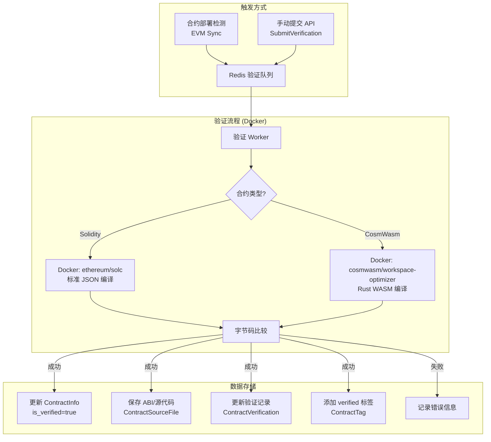

# 智能合约自动验证技术方案

> 日期: 2026-03-02
> 状态: 已实现核心功能

## 一、背景

Injective Chain 区块链浏览器需要增加合约验证功能：
1. **合约标注**：合约部署后自动标注为"未验证"，验证通过后标注为"已验证"
2. **自动校验**：实现 Solidity 合约和原生合约（CosmWasm）的自动验证管线

编译器集成方式采用 **Docker 容器方式**，确保编译环境隔离、版本可控、安全性高。

---

## 二、现有基础设施

| 组件                        | 状态     | 说明                                                                    |
| --------------------------- | -------- | ----------------------------------------------------------------------- |
| `ContractInfo` model        | ✅ 已有   | 包含 `is_verified`, `verification_status`, `verified_at`, `verified_by` |
| `ContractSourceFile` model  | ✅ 已有   | 存储源代码和 ABI 文件                                                   |
| `ContractTag` model         | ✅ 已有   | 合约标签（verified/unverified 等）                                      |
| `contract_verifications` 表 | ✅ 已创建 | 存储验证记录的完整历史                                                  |
| 合约部署检测                | ✅ 已有   | `extract_contract_from_logs.go` 可检测合约创建事件                      |
| `ContractInfoService`       | ✅ 已有   | CRUD + 标签管理已实现                                                   |
| Solidity 编译器集成         | ✅ 已实现 | Docker 容器方式，使用 `ethereum/solc` 镜像                              |
| 自动验证服务                | ✅ 已实现 | `ContractVerificationService`                                           |

---

## 三、整体架构



### 验证流程

```
┌─────────────┐     ┌──────────────┐     ┌───────────────┐     ┌─────────────┐
│ 提交源代码   │ ──→ │ Docker 编译   │ ──→ │ 获取链上字节码  │ ──→ │ 比较字节码   │
└─────────────┘     └──────────────┘     └───────────────┘     └─────────────┘
                                                                      │
                                                            ┌─────────┴──────────┐
                                                            │                    │
                                                       ✅ 匹配              ❌ 不匹配
                                                            │                    │
                                                  ┌─────────┴──┐        ┌───────┴──────┐
                                                  │ 标记为 verified │   │ 标记为 failed   │
                                                  │ 保存 ABI         │   │ 记录错误信息     │
                                                  │ 更新 ContractInfo │   └───────────────┘
                                                  └────────────────┘
```

---

## 四、数据库设计

### contract_verifications 表

存储每次验证的详细记录，迁移脚本：`database/migrations/create_contract_verifications_table.sql`

```sql
CREATE TABLE contract_verifications (
    id BIGINT PRIMARY KEY AUTO_INCREMENT,
    contract_address VARCHAR(128) NOT NULL,
    chain_id VARCHAR(50) DEFAULT 'injective-1',
    contract_type VARCHAR(50) NOT NULL COMMENT 'solidity/cosmwasm',
    verification_type VARCHAR(50) NOT NULL COMMENT 'full_match/partial_match',
    -- Solidity 相关
    compiler_version VARCHAR(100),
    optimization_enabled BOOLEAN DEFAULT FALSE,
    optimization_runs INT DEFAULT 0,
    evm_version VARCHAR(50),
    -- CosmWasm 相关
    cargo_version VARCHAR(100),
    code_id BIGINT,
    -- 通用字段
    license VARCHAR(100),
    source_code MEDIUMTEXT,
    source_code_storage_key VARCHAR(512),
    abi JSON,
    abi_storage_key VARCHAR(512),
    constructor_args TEXT,
    verification_status VARCHAR(50) DEFAULT 'pending' COMMENT 'pending/verifying/verified/failed',
    error_message TEXT,
    verified_at DATETIME(3) NULL,
    verified_by VARCHAR(128),
    created_at DATETIME(3) DEFAULT NULL,
    updated_at DATETIME(3) DEFAULT NULL,
    deleted_at DATETIME(3) DEFAULT NULL,
    INDEX idx_contract_address (contract_address),
    INDEX idx_verification_status (verification_status),
    INDEX idx_chain_id (chain_id),
    INDEX idx_contract_address_chain (contract_address, chain_id)
);
```

### ContractVerification Model

文件：`internal/models/contract_verification.go`

支持 Solidity 和 CosmWasm 两种合约类型，包含验证状态常量：

- `VerificationStatusPending` = "pending"
- `VerificationStatusVerifying` = "verifying"
- `VerificationStatusVerified` = "verified"
- `VerificationStatusFailed` = "failed"

---

## 五、Docker 编译器集成

### 5.1 编译器接口

文件：`internal/service/compiler.go`

```go
// ContractCompiler 统一编译器接口
type ContractCompiler interface {
    Compile(ctx context.Context, req *CompileRequest) (*CompileResult, error)
    Name() string
}
```

### 5.2 Solidity 编译器（Docker 方式）

使用 `ethereum/solc` Docker 镜像，通过标准 JSON 输入/输出进行编译：

```bash
docker run --rm -i --memory=512m --cpus=1 ethereum/solc:{version} --standard-json
```

**配置参数（`SolidityCompilerConfig`）**：

| 参数             | 默认值          | 说明            |
| ---------------- | --------------- | --------------- |
| `DockerImage`    | `ethereum/solc` | Docker 镜像名称 |
| `CompileTimeout` | `30s`           | 编译超时时间    |
| `MaxSourceSize`  | `1MB`           | 源代码最大大小  |
| `UseDocker`      | `true`          | 是否使用 Docker |

**安全限制**：
- 内存限制：512MB (`--memory=512m`)
- CPU 限制：1 核 (`--cpus=1`)
- 超时限制：30 秒
- 源代码大小限制：1MB

**标准 JSON 输入格式**：

支持自动转换：如果提交的是纯 Solidity 源代码，自动包装为标准 JSON 输入格式。如果已经是 JSON 格式，直接透传。

```json
{
  "language": "Solidity",
  "sources": {
    "Contract.sol": { "content": "pragma solidity ^0.8.0; ..." }
  },
  "settings": {
    "optimizer": { "enabled": true, "runs": 200 },
    "evmVersion": "london",
    "outputSelection": { "*": { "*": ["abi", "evm.bytecode", "evm.deployedBytecode"] } }
  }
}
```

### 5.3 CosmWasm 编译器（Docker 方式，待实现）

使用 `cosmwasm/workspace-optimizer` Docker 镜像：

```bash
docker run --rm -v "$PROJECT_DIR":/code \
  --mount type=volume,source=registry_cache,target=/usr/local/cargo/registry \
  cosmwasm/workspace-optimizer:0.14.0
```

比较编译后的 WASM 字节码哈希与链上 `CodeHash` 是否一致。

---

## 六、字节码比较

文件：`internal/service/bytecode_comparator.go`

### 比较策略

| 匹配类型        | 说明                        | 实现方式                               |
| --------------- | --------------------------- | -------------------------------------- |
| `full_match`    | 编译后字节码完全一致        | 直接字符串比较（忽略大小写和 0x 前缀） |
| `partial_match` | 忽略 Solidity metadata hash | 剥离末尾 CBOR metadata 后比较          |

### Solidity Metadata Hash

编译后字节码末尾有一段 CBOR 编码的 metadata，格式为：
- CBOR map marker (`0xa2`, `0xa3` 等)
- 包含 `ipfs` hash 和 `solc` 版本
- 最后 2 字节为 metadata 长度（大端序）

不同编译环境可能因为文件路径等差异生成不同的 metadata hash。`partial_match` 剥离这部分后再比较主体字节码。

---

## 七、验证服务

文件：`internal/service/contract_verification_service.go`

### 核心方法

| 方法                       | 说明                                              |
| -------------------------- | ------------------------------------------------- |
| `SubmitVerification`       | 提交验证请求，创建记录，异步触发验证              |
| `executeVerification`      | 异步执行：编译 → 获取链上字节码 → 比较 → 更新状态 |
| `GetVerificationStatus`    | 查询验证状态                                      |
| `GetContractSourceCode`    | 获取已验证合约的源代码                            |
| `GetContractABI`           | 获取已验证合约的 ABI                              |
| `MarkContractAsUnverified` | 标记新部署的合约为"未验证"（同步管线调用）        |

### 验证成功后的操作

1. 更新 `ContractVerification` 记录状态为 `verified`
2. 更新 `ContractInfo` 表的 `is_verified`, `verification_status`, `verified_at`
3. 更新 `ContractTag` 标签从 "未验证"→"已验证"（颜色 灰→绿）
4. 保存源代码文件到 `ContractSourceFile`
5. 保存 ABI 到对象存储

---

## 八、合约部署自动标注

文件：`internal/service/evm_details_sync.go` 中的 `saveContractInfoIfNotExists` 方法

当 EVM 详情同步检测到合约部署交易（`details.ContractAddress != ""`）时：

1. 创建 `ContractInfo` 记录，设置 `verification_status = "unverified"`
2. 自动添加 `ContractTag`：
   - `tag_type` = "verification_status"
   - `tag_value` = "未验证"
   - `tag_color` = "#808080"（灰色）
   - `is_preset` = true
   - `created_by` = "system"

---

## 九、API 设计

在 `ContractInfoService` 中新增 RPC 方法：

```protobuf
// 提交合约验证
rpc SubmitContractVerification(SubmitContractVerificationRequest) returns (Reply) {
    option (google.api.http) = {
        post: "/api/v1/contract/verify"
        body: "*"
    };
}

// 查询验证状态
rpc GetVerificationStatus(GetVerificationStatusRequest) returns (Reply) {
    option (google.api.http) = {
        get: "/api/v1/contract/verification-status"
    };
}

// 获取合约源代码
rpc GetContractSourceCode(GetContractSourceCodeRequest) returns (Reply) {
    option (google.api.http) = {
        get: "/api/v1/contract/source-code"
    };
}

// 获取合约 ABI
rpc GetContractABI(GetContractABIRequest) returns (Reply) {
    option (google.api.http) = {
        get: "/api/v1/contract/abi"
    };
}
```

---

## 十、配置项

```env
# Contract Verification - Docker Compiler
SOLC_DOCKER_IMAGE=ethereum/solc
SOLC_COMPILE_TIMEOUT=30s
SOLC_MAX_SOURCE_SIZE=1048576
COSMWASM_OPTIMIZER_IMAGE=cosmwasm/workspace-optimizer:0.14.0
VERIFICATION_WORKER_COUNT=2
VERIFICATION_QUEUE_KEY=contract:verification:queue
```

---

## 十一、文件清单

### 新增文件

| 文件路径                                                      | 说明                                         |
| ------------------------------------------------------------- | -------------------------------------------- |
| `internal/models/contract_verification.go`                    | ContractVerification 数据模型                |
| `internal/service/compiler.go`                                | 编译器接口 + Solidity Docker 编译器实现      |
| `internal/service/bytecode_comparator.go`                     | 字节码比较工具（full_match + partial_match） |
| `internal/service/contract_verification_service.go`           | 核心验证服务                                 |
| `internal/service/bytecode_comparator_test.go`                | 字节码比较单元测试                           |
| `database/migrations/create_contract_verifications_table.sql` | 数据库迁移脚本                               |

### 修改文件

| 文件路径                               | 变更                                                   |
| -------------------------------------- | ------------------------------------------------------ |
| `internal/service/evm_details_sync.go` | `saveContractInfoIfNotExists` 新增自动添加"未验证"标签 |

---

## 十二、测试方案

### 单元测试

```bash
# 字节码比较测试
go test ./internal/service/ -run "TestCompareBytecode|TestNormalizeBytecode|TestStripSolidityMetadata" -v

# 现有测试回归
go test ./internal/service/ -run "TestExtractContractFromEvent|TestNonContractCreation" -v
```

### 手动验证

1. **部署合约后检查标注**：部署 Solidity 合约到测试链，确认浏览器显示"未验证"标注
2. **提交验证 API 测试**：通过 curl 调用 `/api/v1/contract/verify` 提交源代码，检查状态变为"已验证"
3. **前端展示验证**：在地址详情页确认合约代码标签页展示正确的已验证/未验证状态
